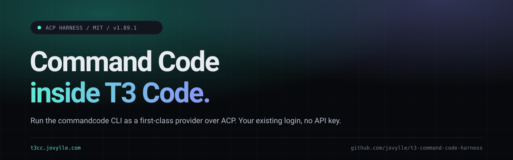
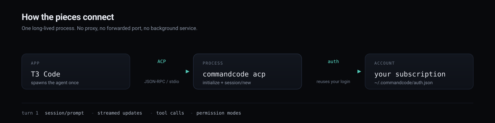
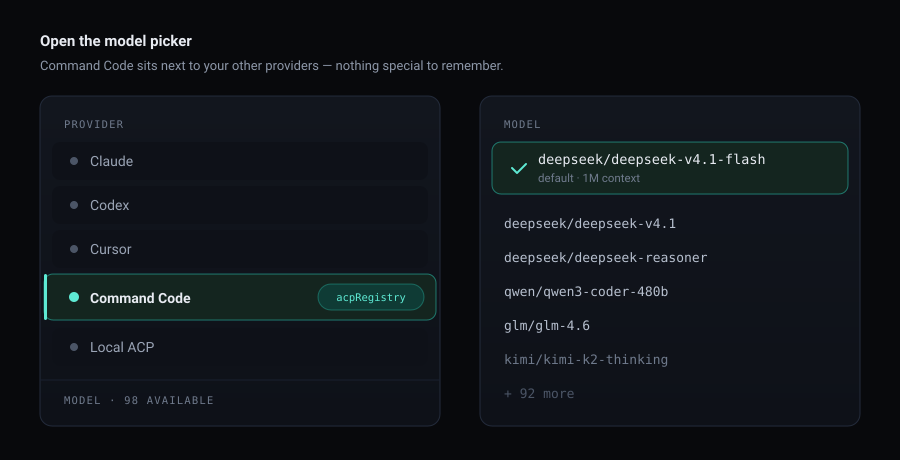
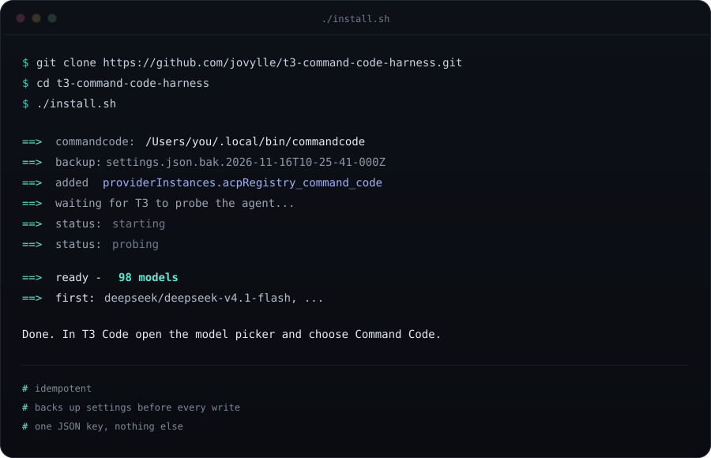

<div align="center">



<br>

**Run the Command Code CLI as a first-class provider inside T3 Code.**
No proxy, no wrapper, no API key — it reuses the login you already have.

<p>
  <a href="https://t3cc.jovylle.com"></a>
  <a href="LICENSE"></a>
  
  
  
</p>

<p>
  <a href="#install"><b>Install</b></a> ·
  <a href="https://t3cc.jovylle.com"><b>Landing page</b></a> ·
  <a href="#gotchas"><b>Gotchas</b></a> ·
  <a href="#manual-install"><b>Manual install</b></a>
</p>

</div>

---

## What this is

The `commandcode` CLI already ships an **ACP agent mode** (`commandcode acp`). T3 Code already
speaks the same Agent Client Protocol. This repo connects the two, so your Command Code
subscription appears next to Claude, Codex and Cursor — with threads, model switching and
permission modes all behaving normally.

<div align="center">

</div>

## What you get

|  |  |
| --- | --- |
| **Provider** | `Command Code` in the T3 model picker — pick a model per thread |
| **Models** | Whatever Command Code serves (~98 today; default `deepseek/deepseek-v4.1-flash`) |
| **Auth** | Reuses `~/.commandcode/auth.json`. Logged in at the CLI means it just works |
| **Modes** | Standard, Accept Edits, Plan, Don't Ask, Bypass — T3 switches map straight through |

<div align="center">

</div>

## Requirements

| Thing | Why |
| --- | --- |
| T3 Code (desktop) | Must support the `acpRegistry` (Local ACP) provider driver |
| `commandcode` CLI, logged in | The agent itself |
| Node.js | `install.sh` uses it to edit `settings.json` safely. T3 ships one |

```bash
commandcode --version        # prints a version
commandcode login            # only if you aren't signed in
ls ~/.commandcode/auth.json  # proof the login is stored
```

<a id="install"></a>
## Install

```bash
git clone https://github.com/jovylle/t3-command-code-harness.git
cd t3-command-code-harness
./install.sh
```

Open T3, hit the model picker, choose **Command Code**, pick a model.

<div align="center">

</div>

The script is idempotent. It:

1. locates the `commandcode` binary (or honors `COMMANDCODE_BIN=/path/to/commandcode`)
2. backs up `~/.t3/userdata/settings.json` to a timestamped `.bak`
3. adds one `providerInstances` entry and nothing else
4. waits for T3 to hot-reload and probe the agent, then prints the model count

T3 watches `settings.json`, so no restart is normally needed. If the provider doesn't show up,
restart T3.

<a id="manual-install"></a>
### Manual install

Add this under `providerInstances` in `~/.t3/userdata/settings.json`, with your own
`command -v commandcode`:

```json
{
  "providerInstances": {
    "acpRegistry_command_code": {
      "driver": "acpRegistry",
      "displayName": "Command Code",
      "enabled": true,
      "config": {
        "source": "local",
        "commandPath": "/Users/you/.local/bin/commandcode",
        "commandArgs": ["acp"]
      }
    }
  }
}
```

Or from the UI: **Settings → Providers → Local ACP**, executable `commandcode`, argument `acp`.

## Verify

```bash
head -20 ~/.t3/caches/acpRegistry_command_code.json
```

You want `"status": "ready"` plus a populated `models` array. `"status": "error"` means the path
is wrong or the CLI isn't logged in.

<a id="gotchas"></a>
## Gotchas

> **1. Don't-ask mode silently kills tools.**
> In a non-prompting permission mode, any tool outside the allowlist is denied *with no prompt*.
> It looks like the agent is broken when it's really the harness refusing. Use a prompting mode
> (Accept Edits / Plan) or add explicit `permissions.allow` rules. This bit us on the very first
> turn after install.

> **2. The CLI self-updates.**
> If it updates mid-thread, the live session can break. Finish or reopen the thread instead of
> expecting the old session to keep going.

> **3. The model list comes from Command Code, not this repo.**
> Different plans expose different models — T3 asks the CLI.

> **4. Version drift.**
> Verified against `command-code` v1.89.1 (ACP handshake + a live turn). If `acp` ever disappears
> from `commandcode --help`, the flag was renamed; the fix is one string in `settings.json`.

## Uninstall

```bash
./uninstall.sh
```

Removes the provider entry (backing up `settings.json` first) and deletes the probe cache. Restart
T3 if it's still listed.

## How it works

`commandcode acp` is an ACP agent on stdio. T3's `acpRegistry` driver spawns it, sends
`initialize`, then `session/new`, and gets back the mode presets plus the model catalog. Every
turn after that is plain ACP traffic. Nothing runs in the background, no port is forwarded.

## Site

The landing page at **https://t3cc.jovylle.com** is plain static HTML/CSS in `site/` — no build
step. It is a Cloudflare Worker with static assets (`wrangler.jsonc`), bound to the custom domain
`t3cc.jovylle.com` on the `jovylle.com` zone.

```bash
npm install --include=dev   # once; this machine's npm omits dev deps by default
npm run dev                 # http://localhost:8787
npm run deploy              # manual deploy
```

Pushing to `main` runs `.github/workflows/deploy.yml`, which deploys with the
`CLOUDFLARE_API_TOKEN` repository secret. That token can read and edit Workers on the account, so
keep it scoped to this repo's secret store and rotate it if it leaks.

The images in `assets/` are hand-written SVG, so they stay sharp at any width and cost a few KB.

## License

MIT
